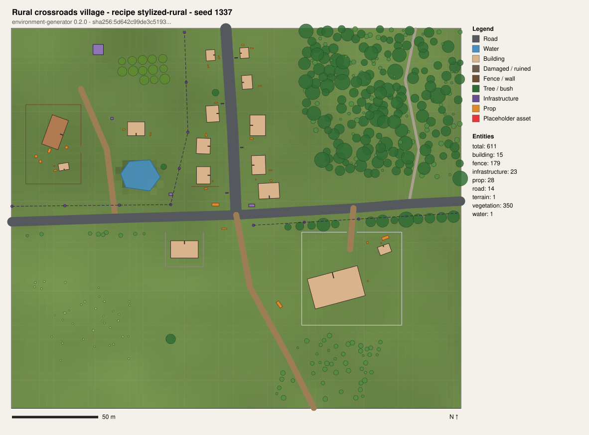

# Environment Generator

[](https://github.com/KirillPadalko/3d-world-production/actions/workflows/ci.yml)

A standalone, deterministic procedural environment generator for an isometric
tactical game. It turns a **LocationBlueprint** (a structured description of a
real place) and a **LocationRecipe** (how to stylise it), plus optional
**LocationOverrides** (designer edits), into a portable, engine-agnostic
**scene manifest**: terrain, roads, buildings, fences, infrastructure,
vegetation, props and atmosphere, each entity with a stable ID, archetype,
transform, parameters and provenance.



*Top-down preview of `examples/expected-output/rural-crossroads.stylized-rural`
(638 entities, generated in about 0.15 s).*

## Where this fits

```
drone footage -> frames -> location analysis -> LocationBlueprint -> LocationRecipe -> asset selection
  -> procedural generation -> scene manifest -> Blender processing -> Unity integration -> validation
                 ^^^^^^^^^^^^^^^^^^^^^^^^^^^^^^^^^^^^^^^^^^^^^^^^^^^^^^^
                 implemented here (blueprint -> validated manifest)
```

| Part of the workflow | Status |
| --- | --- |
| Blueprint / recipe / overrides contracts (Pydantic + JSON Schema) | **Implemented** |
| Validation (contract, semantic, generated layout) | **Implemented** |
| Planning, 8 generator slots, asset resolution, manifest export, reports | **Implemented** |
| CLI, SVG preview, dry run, replay from a saved plan | **Implemented** |
| Unity coordinate conversion helpers (pure math) | **Implemented** |
| Drone footage / location analysis | Interface + stub (fails loudly) |
| Blender processing | Interface + stub (fails loudly) |
| Unity scene import | Interface + stub; the manifest is the integration contract |

No external services, accounts, API keys, MCP servers, Unity or Blender are
needed. The core imports only the standard library and Pydantic.

## Quick start

Requires Python 3.11+ and [uv](https://docs.astral.sh/uv/).

```bash
uv sync                      # creates .venv from uv.lock (reproducible)

uv run envgen generate \
  --blueprint examples/blueprints/rural-crossroads.blueprint.json \
  --recipe    examples/recipes/stylized-rural.recipe.json \
  --overrides examples/overrides/rural-crossroads.designer-pass.overrides.json \
  --output-dir out/rural --preview

uv run envgen verify out/rural/scene-manifest.json
```

`out/rural` now contains `scene-manifest.json`, `generation-report.json` and
`preview.svg`. Running the same command again produces byte-identical files.

Without uv: `python -m venv .venv && .venv/bin/pip install -e .` and use
`.venv/bin/envgen`.

## Command line

| Command | Purpose |
| --- | --- |
| `envgen validate -b BLUEPRINT [-r RECIPE] [-o OVERRIDES]` | Contract + semantic validation, no generation |
| `envgen plan -b ... [--seed N] [--output plan.json]` | Dry run: stages 1-4, prints and optionally saves the plan |
| `envgen generate -b ... -d DIR [--seed N] [--dry-run] [--preview] [--write-plan] [--no-timings]` | Full pipeline |
| `envgen generate --plan plan.json -d DIR` | Generate from a saved plan (stages 5-8) |
| `envgen preview MANIFEST [--output file.svg]` | Render a manifest as a top-down SVG |
| `envgen verify MANIFEST` | Check a manifest against its content hash |
| `envgen schema export\|check [--output-dir schemas]` | Regenerate / drift-check the public JSON Schemas |
| `envgen assets list [--registry FILE] [--category C]` | Inspect an asset registry |
| `envgen adapters list` | Show integration points and whether they are real or stubs |

Exit codes: `0` success, `2` usage, `3` invalid input, `4` asset/planning/generation
failure, `5` layout validation failed, `6` export failure, `7` adapter unavailable.
`--recipe` defaults to a built-in recipe; `--registry` defaults to the built-in
archetype registry (or `ENVGEN_ASSET_REGISTRY`).

## Library use

```python
from pathlib import Path
from environment_generator.pipeline import InputBundle, Pipeline, PipelineOptions

result = Pipeline().run(
    InputBundle(
        blueprint=Path("examples/blueprints/minimal.blueprint.json"),
        recipe=None,  # built-in default recipe
        seed_override=7,
    ),
    PipelineOptions(output_dir=Path("out/minimal"), write_preview=True),
)
if not result.success:
    raise SystemExit(result.error)
for entity in result.manifest.entities:
    print(entity.id, entity.archetype_id, entity.transform.position)
```

Every stage is also usable on its own (`LoadInputsStage`, `ResolveInputsStage`,
`ResolveAssetsStage`, `PlanGenerationStage`, `GenerateSceneStage`,
`ValidateLayoutStage`, `ExportManifestStage`, `BuildReportStage`), and any
generator, the validator or the exporter can be replaced through the
`Pipeline` constructor. See [docs/ARCHITECTURE.md](docs/ARCHITECTURE.md).

## Inputs and outputs

* **LocationBlueprint** ([schema](schemas/location-blueprint.schema.json)) - what
  is there: extent, terrain and spot heights, zones, roads, buildings,
  vegetation, water, fences, infrastructure, props, observed atmosphere. Features
  use GeoJSON-like geometry in local metres and carry an analysis `confidence`.
* **LocationRecipe** ([schema](schemas/location-recipe.schema.json)) - how to turn
  it into a game map: master seed, asset tag preferences, per-generator
  settings (zone infill, damage ratio, vegetation density, street lights,
  clutter, lighting overrides) and layout validation limits.
* **LocationOverrides** ([schema](schemas/location-overrides.schema.json)) -
  designer edits that survive regeneration: recipe merge patch, seed,
  add/remove/patch blueprint features, and remove/re-skin/move generated
  entities by stable ID.
* **Asset registry** ([schema](schemas/asset-registry.schema.json)) - abstract
  archetypes with nominal dimensions, tags, variants, biomes, tactical cover
  hints and an opaque `asset_ref` that an engine maps to real assets.
* **Scene manifest** ([schema](schemas/scene-manifest.schema.json)) - the
  output: heightfield, atmosphere, entities sorted by ID, statistics and a
  `sha256` content hash.

Examples live in [`examples/`](examples/); the expected outputs for three
input combinations are committed under
[`examples/expected-output/`](examples/expected-output/) and checked by the
golden tests.

## Determinism

Same blueprint + recipe + overrides + registry + generator version + seed
=> byte-identical manifest, on any platform, across processes and
`PYTHONHASHSEED` values. The generator uses its own specified PRNG
(xoshiro256** seeded through SplitMix64), derives every random stream from
labelled SHA-256 hashes (per generator, per feature, per candidate), sorts
everything it emits and rounds floats to 0.1 mm in outputs. Entity IDs are
derived from blueprint feature IDs, so local edits do not renumber unrelated
entities. Details: [docs/GENERATION_PIPELINE.md](docs/GENERATION_PIPELINE.md#determinism).

## Repository layout

```
schemas/                     public JSON Schemas (generated from the models, drift-checked in CI)
src/environment_generator/
  core/          errors, issues, geometry, PRNG, hashing, spatial index, terrain sampling
  models/        Pydantic contracts and stage models; JSON Schema export
  validation/    contract loading, semantic checks, layout validator + rules
  assets/        registry loading, palette filtering, deterministic asset resolver
  generators/    generator slot interfaces + built-in implementations
  planning/      dependency ordering and seed derivation
  pipeline/      the eight stages, override application, orchestrator
  exporters/     portable JSON manifest exporter
  reporting/     text summary and SVG preview
  adapters/      external integration interfaces (stubs) + Unity coordinate helpers
  cli/           envgen command line
examples/                    blueprints, recipes, overrides, expected output
tests/                       unit, integration (end-to-end, determinism, golden), contract
scripts/                     maintenance scripts (regenerate expected output)
docs/                        architecture, pipeline, adapters, development, roadmap
```

## Documentation

* [Architecture](docs/ARCHITECTURE.md) - boundaries, interfaces, design decisions
* [Generation pipeline](docs/GENERATION_PIPELINE.md) - stages, coordinate system, IDs, determinism, manifest format
* [Adapters](docs/ADAPTERS.md) - integration points and a Unity integration guide
* [Development](docs/DEVELOPMENT.md) - setup, tests, schemas, adding generators
* [Roadmap](docs/ROADMAP.md) - next phases and known limitations

## License

MIT, see [LICENSE](LICENSE).
