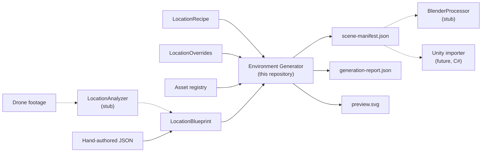

# Architecture

## Goals and non-goals

The Environment Generator is an **isolated, engine-agnostic** framework that
turns structured descriptions of real locations into stylised, game-ready
environment descriptions. This phase delivers the architecture and a working
MVP that runs on its own:

* in scope: public contracts, validation, planning, deterministic procedural
  generation, asset abstraction, a portable scene manifest, reports, CLI, a
  preview, tests and CI;
* out of scope (interfaces only): footage analysis, Blender processing, Unity
  import, any network, account or MCP integration. Outside the core, footage
  analysis is done by Claude with the `video-to-blueprint` skill
  (`.claude/skills/`) and Unity import by the package in `integrations/unity`.

Nothing in the core imports Unity, `bpy`, MCP SDKs or AI SDKs, and no adapter
pretends to work: stubs raise `AdapterUnavailableError`.

## System context



Dashed arrows are future integrations. Two contracts are the integration
boundaries: upstream, the **LocationBlueprint** (a location package; see
[LOCATION_BLUEPRINT.md](LOCATION_BLUEPRINT.md)) that analysis tools produce;
downstream, the **scene manifest** (`schemas/scene-manifest.schema.json`).
Both use the same spatial frame (metres, `+X` east, `+Y` up, `+Z` north, yaw
clockwise from north).

## Package structure and dependency rules

```
core  <-  models  <-  validation, assets  <-  generators  <-  planning  <-  pipeline  <-  cli
                      blueprint (core + models + validation)  <-  pipeline, cli
                         exporters, reporting (core + models [+ validation])
                         adapters (core + models only; never imported by the core)
```

| Package | Responsibility | May import |
| --- | --- | --- |
| `core` | Errors, validation issues, 2D geometry, frame conversion, road curves, PRNG and seed derivation, canonical JSON/hashing, spatial index, heightfield/noise, JSON merge patch | stdlib, pydantic |
| `models` | Public contracts (`models/blueprint/` = LocationBlueprint v1.0, recipe, overrides, registry, manifest), the internal site description, stage models (plan, scene, report), JSON Schema export | `core` |
| `blueprint` | LocationBlueprint services: versioning and migrations, IO and canonical serialization, validation phases and diagnostics, external file checks, entity operations (overrides), conversion to the site description | `core`, `models`, `validation` |
| `validation` | Document loading, contract errors, recipe/registry/compatibility checks, layout validator and rules | `core`, `models` |
| `assets` | Built-in registry, palette filtering, `AssetResolver` | `core`, `models` |
| `generators` | Generator slot interfaces, `GenerationContext`, built-in implementations | `core`, `models`, `assets` |
| `planning` | Dependency ordering, seed derivation, plan assembly | above |
| `exporters` | `SceneExporter`, JSON manifest | `core`, `models`, `validation` |
| `reporting` | Text summary, SVG preview (reads only the manifest) | `core`, `models` |
| `pipeline` | The eight stages, placement overrides, `Pipeline` orchestrator | all of the above |
| `adapters` | External integration interfaces, stubs, Unity coordinate math | `core`, `models` |
| `cli` | `envgen` | everything |

These rules are enforced by `tests/unit/test_architecture.py`, which parses
every source file and fails on a forbidden internal import, on any engine,
network or AI SDK import (`bpy`, `UnityEngine`, `mcp`, `anthropic`,
`openai`, `requests`, ...), or on any third-party import other than `pydantic`.

## Contracts

| Contract | Model | Schema | Direction |
| --- | --- | --- | --- |
| LocationBlueprint v1.0 | `models.blueprint.LocationBlueprint` | `schemas/location-blueprint.schema.json` | input ([spec](LOCATION_BLUEPRINT.md)) |
| LocationRecipe | `models.recipe.LocationRecipe` | `schemas/location-recipe.schema.json` | input |
| LocationOverrides | `models.overrides.LocationOverrides` | `schemas/location-overrides.schema.json` | input |
| Asset registry | `models.assets.AssetRegistryDocument` | `schemas/asset-registry.schema.json` | input |
| Scene manifest | `models.scene.SceneManifest` | `schemas/scene-manifest.schema.json` | output |

The Pydantic models are the single source of truth. `envgen schema export`
writes the JSON Schemas (2020-12) and CI runs `envgen schema check` so the
committed files cannot drift. Contract tests validate every example against
the committed schemas with the independent `jsonschema` validator and check
that invalid fixtures are rejected by both the schema and the models.

Rules that JSON Schema cannot express are checked in code and reported as
structured diagnostics (severity, code, category, path, entity IDs,
suggestion): for blueprints the semantic, reference and external-file phases
in `blueprint/validation.py` (document-wide unique IDs, simple polygons,
bounds, road graph, fence missing sections, parent cycles, provenance,
heightmap files); for recipes and registries `validation/semantic.py`
(applicability, reserved IDs, constraint ranges).

All models are immutable (`frozen=True`), reject unknown fields
(`extra="forbid"`) and reject NaN/infinity. Public documents use camelCase
JSON keys only, so typos and snake_case leftovers fail loudly and every
output is serialisable.

### Blueprint, site description and generator frame

The public blueprint is rich (provenance, plots, gameplay, external rasters,
road graphs). Generators work on an internal **site description**
(`models/site.py`) built by `blueprint/site_adapter.py` in stage 2: road
curves are sampled, heightmaps decoded, missing fence sections turned into
gaps, wires attached to poles, and everything converted from the location
frame (Y up, clockwise yaw) into the generator frame (Z up, counter-clockwise
yaw). The exporter converts generated entities back, so the manifest uses the
blueprint's frame. `core/frames.py` is the only conversion code; nothing
reinterprets axes implicitly. Blueprint data the generators do not use yet is
reported as `NOT_INTERPRETED` info and landmarks and gameplay annotations are
copied to the manifest.

## Interfaces

| Interface | Module | Built-in implementation |
| --- | --- | --- |
| `TerrainGenerator` | `generators/base.py` | `HeightfieldTerrainGenerator` |
| `RoadGenerator` | `generators/base.py` | `PolylineRoadGenerator` |
| `BuildingGenerator` | `generators/base.py` | `FootprintBuildingGenerator` |
| `FenceGenerator` | `generators/base.py` | `PanelFenceGenerator` |
| `InfrastructureGenerator` | `generators/base.py` | `StandardInfrastructureGenerator` |
| `VegetationGenerator` | `generators/base.py` | `ScatterVegetationGenerator` |
| `PropGenerator` | `generators/base.py` | `ClutterPropGenerator` |
| `AtmosphereProcessor` | `generators/base.py` | `PresetAtmosphereProcessor` |
| `AssetResolver` | `assets/resolver.py` | `PaletteAssetResolver` |
| `SceneExporter` | `exporters/base.py` | `JsonManifestExporter` |
| `EnvironmentValidator` | `validation/layout.py` | `RuleBasedLayoutValidator` (+ `LayoutRule`s) |
| `LocationAnalyzer` | `adapters/location_analysis.py` | `UnconfiguredLocationAnalyzer` (stub) |
| `BlenderProcessor` | `adapters/blender.py` | `UnconfiguredBlenderProcessor` (stub) |
| `UnitySceneIntegrator` | `adapters/unity.py` | `UnconfiguredUnityIntegrator` (stub) |

Every generator slot interface derives from `SceneGenerator` and fixes:

* `slot` - its name in the plan and the recipe section that enables it;
* `dependencies` - ordering constraints (e.g. vegetation runs after buildings
  so it can avoid them);
* `produces` - the asset categories it may emit (checked by the pipeline);
* `estimate(site, recipe)` - cheap, side-effect-free work estimate with
  source features and asset needs (used for planning and asset checks);
* `generate(context)` - the actual work, returning a `GeneratorOutput`.

`GeneratorSet` holds exactly one implementation per slot and rejects an
implementation placed in the wrong slot. Implementations identify themselves
as `implementation@version`; the identifier is stored in the plan and in every
entity's provenance, and generating from a saved plan fails if the configured
implementation differs.

### GenerationContext

Generators receive a `GenerationContext` with the site description, the
effective recipe, the resolved generation controls (`structuralSimilarity`,
`visualVariation`, `detailDensity`, `abandonment`), their task seed, the
`AssetResolver`, a `HeightSampler` (flat until the terrain generator has run),
the shared `SpatialIndex` of occupied footprints and a read-only view of the
entities produced so far. `context.rng(*labels)` returns an independent random
stream for any label path.

## Key design decisions

1. **Pydantic models as the source of truth, JSON Schema generated.** One
   definition, typed Python access, and language-neutral contracts for future
   producers (analysis tools) and consumers (Unity importer).
2. **Three separate input contracts.** The blueprint says what is there (with
   provenance), the recipe how to interpret any location, the overrides what
   an author changed for one location. None contains another's data, and
   applying overrides never modifies the blueprint.
3. **The manifest is the integration boundary.** Generators never call an
   engine. Engines read a self-describing JSON file with explicit coordinate
   conventions, archetype references and provenance.
4. **Own PRNG and hash-derived seeds.** Python's `random` only guarantees the
   `random()` stream across versions; xoshiro256** + SplitMix64 is fully
   specified and portable to C#. Seeds are derived per generator, per feature
   and per candidate, so enabling, disabling or editing one thing does not
   reshuffle the rest.
5. **Stable, semantic entity IDs** derived from blueprint entity IDs and local
   indices (`vegetation.vz-forest-north.00042`), never from global counters.
   This makes entity-level overrides possible and keeps engine-side references
   valid across regenerations.
6. **Independent layout validation.** The validator recomputes footprints from
   the finished scene instead of trusting the generators' occupancy index, so
   it also checks third-party generator implementations.
7. **Explicit placeholders.** When no archetype fits, the resolver either fails
   (recipe `fallback: error`) or emits a clearly marked `placeholder.*`
   archetype that the report and preview flag. Nothing is silently substituted.
8. **Stages with typed inputs and outputs.** Each stage is a class with a
   `run(input) -> StageOutcome[output]` method, so it can be tested, replaced
   or run alone. The plan is self-contained (site description, recipe,
   controls, palette, seeds, placement overrides), so generation can be
   replayed from a saved plan.
9. **Small dependency footprint.** Runtime: `pydantic` only. Development:
   `pytest`, `pytest-cov`, `jsonschema`, `ruff`, `mypy`. `uv.lock` pins versions.

## Extension points

* **Replace a generator:** subclass the slot interface (or an existing
  implementation), set `implementation`/`version`, and pass a `GeneratorSet`
  to `Pipeline(generators=...)`.
* **Add layout rules:** subclass `LayoutRule` and pass
  `RuleBasedLayoutValidator([*default_rules(), MyRule()])` to
  `Pipeline(validator=...)`.
* **Another output format:** implement `SceneExporter` and pass it to
  `Pipeline(exporter=...)`.
* **Engine assets:** supply a registry with the same schema whose `assetRef`
  values are engine asset keys (`--registry`).
* **External systems:** implement an adapter interface in `adapters/`; see
  [ADAPTERS.md](ADAPTERS.md).

## Error handling

All expected failures raise a subclass of `EnvironmentGeneratorError` carrying
a stable `code`, an `exit_code` and a list of `ValidationIssue`s
(`severity`, `code`, `message`, `category`, `location`, `path`, `entityIds`,
`suggestion`).

| Exception | Code | Exit | Raised by |
| --- | --- | --- | --- |
| `InputLoadError` | `INPUT_LOAD_ERROR` | 3 | missing/unreadable file, invalid JSON |
| `UnsupportedVersionError` | `UNSUPPORTED_SCHEMA_VERSION` | 3 | blueprint schema version cannot be read |
| `MigrationError` | `MIGRATION_ERROR` | 3 | the blueprint needs migration, or a migration failed |
| `ExternalDataError` | `EXTERNAL_DATA_ERROR` | 3 | a referenced file (heightmap) cannot be used |
| `ContractValidationError` | `CONTRACT_VALIDATION_ERROR` | 3 | model/schema violations (all documents reported together) |
| `SemanticValidationError` | `SEMANTIC_VALIDATION_ERROR` | 3 | semantic, reference or file checks |
| `OverrideError` | `OVERRIDE_ERROR` | 3 | overrides that cannot be applied |
| `AssetResolutionError` | `ASSET_RESOLUTION_ERROR` | 4 | missing archetypes with `fallback: error` |
| `PlanningError` | `PLANNING_ERROR` | 4 | dependency cycles, plan/generator mismatch |
| `GenerationError` | `GENERATION_ERROR` | 4 | a generator crashed or broke its slot contract |
| `LayoutValidationError` | `LAYOUT_VALIDATION_ERROR` | 5 | layout errors with `fail_on_error` |
| `ExportError` | `EXPORT_ERROR` | 6 | manifest or report cannot be written |
| `AdapterUnavailableError` | `ADAPTER_UNAVAILABLE` | 7 | a stub adapter was called |

`Pipeline.run` never raises these: it records the failed stage, marks later
stages as skipped, writes `generation-report.json` (when an output directory
is given) and returns a `PipelineResult` with `error` set. Unexpected
exceptions (bugs) propagate.

## Logging

Modules log through `logging.getLogger(__name__)`; the pipeline logs stage
start/finish at INFO. The CLI configures logging on stderr (`-v` INFO, `-vv`
DEBUG, or `ENVGEN_LOG_LEVEL`); stdout carries only command output.
